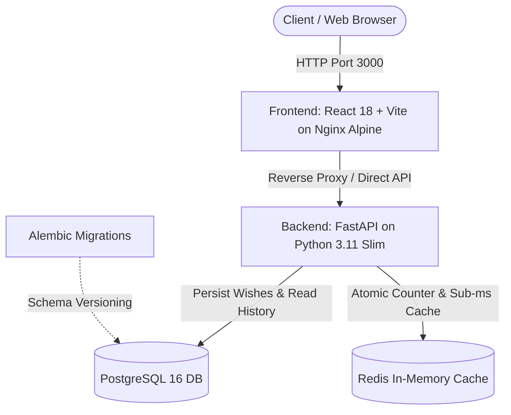

# Birthday Wisher 🎂✨

A modern, production-ready, containerized full-stack cloud application built to study Dockerization, database migrations, caching strategies, and deployment on **Azure 12-Month Free Tier** services.

---

## 🏛️ System Architecture



---

## 📦 Tech Stack

- **Frontend:** React 18, Vite (Node 20 / NVM compatible), Canvas Confetti, Lucide Icons, Vanilla CSS with custom modern design system.
- **Backend:** Python 3.11, FastAPI, SQLAlchemy 2.0 (Declarative Base), Pydantic v2, `psycopg2-binary`, `redis-py`.
- **Database & Migrations:** PostgreSQL 16 Alpine, Alembic (with full auto-generation support).
- **Caching:** Redis 7 Alpine (atomic counter with automated database fallback).
- **Containerization:** Multi-stage `Dockerfile`s, Nginx reverse proxy, non-root Linux users, healthchecks, Docker Compose.
- **Cloud Platform:** Microsoft Azure (Azure Container Apps, Azure Database for PostgreSQL Flexible Server, Azure Container Registry).

---

## 📂 Project Directory Structure

```text
birthday-wisher/
├── backend/
│   ├── app/
│   │   ├── api/
│   │   │   ├── __init__.py
│   │   │   └── endpoints.py         # REST endpoints (/wish, /wishes, /wishes/count, /health)
│   │   ├── core/
│   │   │   ├── __init__.py
│   │   │   └── config.py            # Pydantic BaseSettings environment config
│   │   ├── db/
│   │   │   ├── __init__.py
│   │   │   ├── base.py              # SQLAlchemy 2.0 DeclarativeBase
│   │   │   └── session.py           # Database engine & sessionmaker dependency
│   │   ├── models/
│   │   │   ├── __init__.py
│   │   │   └── wish.py              # Wish database model (id, name, created_at)
│   │   ├── schemas/
│   │   │   ├── __init__.py
│   │   │   └── wish.py              # Pydantic v2 validation & response schemas
│   │   ├── services/
│   │   │   ├── __init__.py
│   │   │   └── redis_service.py     # Redis helper with resilient DB fallback
│   │   ├── __init__.py
│   │   └── main.py                  # FastAPI app factory & CORS configuration
│   ├── alembic/
│   │   ├── versions/
│   │   │   └── 0001_initial_schema.py # Pre-generated initial schema migration
│   │   ├── env.py                   # Alembic environment linked to Base.metadata
│   │   └── script.py.mako
│   ├── alembic.ini                  # Alembic CLI configuration
│   ├── requirements.txt             # Python dependencies
│   └── Dockerfile                   # Multi-stage/secure non-root Python container
├── frontend/
│   ├── src/
│   │   ├── App.jsx                  # Main interactive celebration UI component
│   │   ├── App.css                  # Custom glassmorphism, animations & responsive grid
│   │   ├── main.jsx                 # React root entry point
│   │   └── index.css                # Design tokens, typography & CSS resets
│   ├── nginx.conf                   # Production Nginx server & reverse proxy
│   ├── index.html                   # HTML entry point with web fonts
│   ├── package.json                 # Node dependencies
│   ├── vite.config.js               # Vite build & local dev proxy setup
│   ├── .nvmrc                       # Node 20 runtime pinning
│   └── Dockerfile                   # Multi-stage Node builder -> Nginx Alpine
├── .env.example                     # Environment template
├── .env                             # Local environment variables
├── .gitignore                       # Git ignore definitions
├── docker-compose.yml               # Local container orchestrator
└── README.md                        # Full documentation & deployment guide
```

---

## 🚀 Part 1: Local Development & Docker Stack Workflow

### 1. Initialize Local Environment

Copy the example environment file (already prepared):
```bash
cp .env.example .env
```

### 2. Build and Start the Docker Stack

Launch all four containers (`frontend`, `backend`, `db`, and `redis`) in detached mode:
```bash
docker compose up --build -d
```

### 3. Verify Container Health

Check that all services are healthy and running:
```bash
docker compose ps
```

*Output should indicate healthy status:*
```text
NAME                IMAGE                     COMMAND                  SERVICE    STATUS
birthday_backend    birthday-wisher-backend   "uvicorn app.main:ap…"   backend    Up (healthy)
birthday_db         postgres:16-alpine        "docker-entrypoint.s…"   db         Up (healthy)
birthday_frontend   birthday-wisher-frontend  "/docker-entrypoint.…"   frontend   Up (healthy)
birthday_redis      redis:7-alpine            "docker-entrypoint.s…"   redis      Up (healthy)
```

### 4. Execute Database Migrations

Apply the initial Alembic database migration inside the running backend container:
```bash
docker compose exec backend alembic upgrade head
```

#### How to Create New Migrations (Autogenerate):
Whenever you modify models in `backend/app/models/`:
```bash
docker compose exec backend alembic revision --autogenerate -m "describe_your_change"
docker compose exec backend alembic upgrade head
```

### 5. Access the Running Application

| Service | URL | Description |
| :--- | :--- | :--- |
| **Frontend Web App** | [http://localhost:3000](http://localhost:3000) | Interactive React UI with Confetti & Wish Wall |
| **Backend API Docs** | [http://localhost:8000/api/v1/docs](http://localhost:8000/api/v1/docs) | Swagger UI for testing API endpoints |
| **Health Check** | [http://localhost:8000/api/v1/health](http://localhost:8000/api/v1/health) | Live DB & Redis connectivity status |

### 6. Verify Redis Cache in Action

Inspect the cached counter key directly in the Redis container:
```bash
docker compose exec redis redis-cli get birthday:total_wishes
```

---

## 🔒 Part 2: Git & Private GitHub Setup

Run these commands from the `birthday-wisher` root directory to initialize Git and push to a private GitHub repository:

```bash
# 1. Initialize Git repository
git init -b main

# 2. Check status and ensure .env and node_modules are ignored
git status

# 3. Stage all source files
git add .

# 4. Commit changes
git commit -m "feat: initial commit of Birthday Wisher containerized stack"

# 5. Create a new private repository on GitHub (via GitHub CLI or web UI)
# Using GitHub CLI:
gh repo create birthday-wisher --private --source=. --remote=origin --push

# OR Using standard git remote if created via GitHub Web:
# git remote add origin https://github.com/<YOUR_USERNAME>/birthday-wisher.git
# git push -u origin main
```

---

## ☁️ Part 3: Azure 12-Month Free Tier Deployment Guide

This guide details how to host this application on Microsoft Azure while staying strictly within the **Azure 12-Month Free Services & Always-Free Limits**.

### 💡 Azure Free Tier Resources Used:
1. **Azure Database for PostgreSQL Flexible Server:** 750 hours/month free for 12 months (`Standard_B1ms` Burstable compute + 32 GB storage).
2. **Azure Container Registry (ACR):** Standard / Basic tier.
3. **Azure Container Apps:** Monthly free grant (180,000 vCPU-seconds, 360,000 GiB-seconds, and 2 million requests free per month).
4. **Redis:** Use local containerized Redis, or connect to **Upstash Free Redis** (10,000 commands/day free forever) or Azure Redis Cache.

---

### Step-by-Step Deployment Commands (Azure CLI)

#### Step 1: Login and Set Variables
```bash
az login

# Set your target Azure region and naming variables
export LOCATION="eastus"
export RG_NAME="rg-birthday-wisher-prod"
export ACR_NAME="acrbirthdaywisher$RANDOM"
export PG_SERVER="psql-birthday-$RANDOM"
export PG_ADMIN_USER="azureadmin"
export PG_ADMIN_PASS="ChangeThisSecurePass123!"
export PG_DB_NAME="birthday_db"
export ACA_ENV="env-birthday-wisher"

# 1. Create Resource Group
az group create --name $RG_NAME --location $LOCATION
```

#### Step 2: Provision Free Azure Database for PostgreSQL (Flexible Server)
```bash
az postgres flexible-server create \
  --resource-group $RG_NAME \
  --name $PG_SERVER \
  --location $LOCATION \
  --admin-user $PG_ADMIN_USER \
  --admin-password $PG_ADMIN_PASS \
  --sku-name Standard_B1ms \
  --tier Burstable \
  --storage-size 32 \
  --version 16 \
  --database-name $PG_DB_NAME \
  --yes

# Allow Azure Services to connect to PostgreSQL (Firewall rule)
az postgres flexible-server firewall-rule create \
  --resource-group $RG_NAME \
  --name $PG_SERVER \
  --rule-name AllowAzureServices \
  --start-ip-address 0.0.0.0 \
  --end-ip-address 0.0.0.0
```

#### Step 3: Create Azure Container Registry (ACR) and Build Images
```bash
# Create ACR
az acr create \
  --resource-group $RG_NAME \
  --name $ACR_NAME \
  --sku Basic \
  --admin-enabled true

# Get ACR Login Server & Password
export ACR_LOGIN_SERVER=$(az acr show --name $ACR_NAME --query loginServer --output tsv)
export ACR_PASSWORD=$(az acr credential show --name $ACR_NAME --query "passwords[0].value" --output tsv)

# Build and Push Backend Image directly to ACR using Azure Cloud Build
az acr build \
  --registry $ACR_NAME \
  --image birthday-backend:latest \
  ./backend

# Build and Push Frontend Image directly to ACR
az acr build \
  --registry $ACR_NAME \
  --image birthday-frontend:latest \
  ./frontend
```

#### Step 4: Create Azure Container Apps Environment
```bash
# Register Microsoft.App provider if not already registered
az provider register --namespace Microsoft.App

# Create Container Apps Managed Environment
az containerapp env create \
  --name $ACA_ENV \
  --resource-group $RG_NAME \
  --location $LOCATION
```

#### Step 5: Deploy Backend to Azure Container Apps
```bash
# Construct Azure PostgreSQL Connection URL
export AZURE_DB_URL="postgresql://${PG_ADMIN_USER}:${PG_ADMIN_PASS}@${PG_SERVER}.postgres.database.azure.com:5432/${PG_DB_NAME}?sslmode=require"

# Deploy Backend Container App
az containerapp create \
  --name backend-app \
  --resource-group $RG_NAME \
  --environment $ACA_ENV \
  --image $ACR_LOGIN_SERVER/birthday-backend:latest \
  --registry-server $ACR_LOGIN_SERVER \
  --registry-username $ACR_NAME \
  --registry-password $ACR_PASSWORD \
  --target-port 8000 \
  --ingress external \
  --cpu 0.25 \
  --memory 0.5Gi \
  --min-replicas 1 \
  --max-replicas 2 \
  --env-vars \
    DATABASE_URL="$AZURE_DB_URL" \
    REDIS_HOST="" \
    ALLOWED_ORIGINS="*"

# Retrieve Backend Public URL
export BACKEND_FQDN=$(az containerapp show --name backend-app --resource-group $RG_NAME --query "properties.configuration.ingress.fqdn" --output tsv)
echo "Backend is live at: https://${BACKEND_FQDN}"
```

#### Step 6: Run Database Migrations on Azure
Execute Alembic migrations inside the deployed Azure container:
```bash
az containerapp exec \
  --name backend-app \
  --resource-group $RG_NAME \
  --command "alembic upgrade head"
```

#### Step 7: Deploy Frontend to Azure Container Apps
```bash
# Deploy Frontend Container App connected to the Backend URL
az containerapp create \
  --name frontend-app \
  --resource-group $RG_NAME \
  --environment $ACA_ENV \
  --image $ACR_LOGIN_SERVER/birthday-frontend:latest \
  --registry-server $ACR_LOGIN_SERVER \
  --registry-username $ACR_NAME \
  --registry-password $ACR_PASSWORD \
  --target-port 80 \
  --ingress external \
  --cpu 0.25 \
  --memory 0.5Gi \
  --min-replicas 1 \
  --max-replicas 2 \
  --env-vars \
    VITE_API_URL="https://${BACKEND_FQDN}/api/v1"

# Retrieve Frontend Public URL
export FRONTEND_FQDN=$(az containerapp show --name frontend-app --resource-group $RG_NAME --query "properties.configuration.ingress.fqdn" --output tsv)
echo "🎉 Congratulations! Your Birthday Wisher app is live at: https://${FRONTEND_FQDN}"
```

---

## 🧹 Teardown / Cleanup
To prevent any unexpected billing after studying the deployment:
```bash
az group delete --name $RG_NAME --yes --no-wait
```

---

## 📜 License
MIT License. Created for cloud architecture study and DevOps practice.
